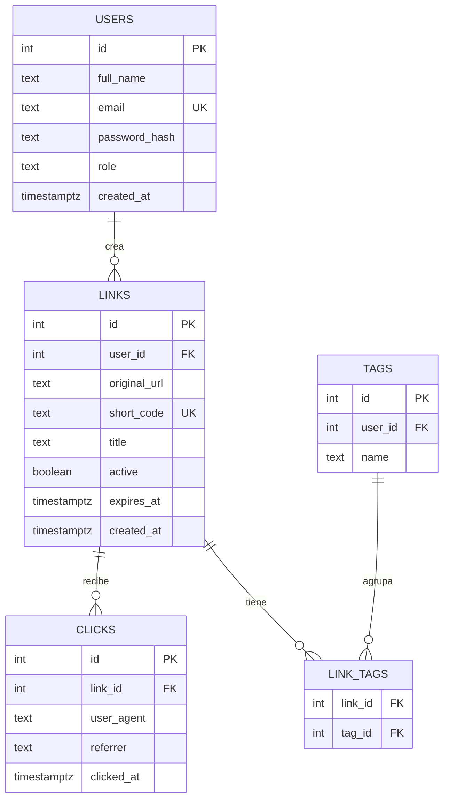

# PRD · Acortador URL

> Documento de requisitos del producto (Product Requirements Document).
> Complétalo en el Sprint 0 (historia H0.3) y pide la aprobación del profesor en un Issue.
> Cada requisito funcional (RF) se convierte en un Issue con la plantilla "Historia de usuario".

| Campo | Valor |
| --- | --- |
| Alumno | Isaac Ortega |
| Proyecto n.º | 36 |
| Sitio de referencia | Bitly |
| Compañero revisor | Vicente Castellón |
| URL desplegada | (se completa en el Sprint 5) |

## 1. Problema

Los enlaces largos y complejos resultan difíciles de compartir en redes sociales, mensajes o material impreso, y no ofrecen visibilidad sobre cuántas personas los abren. Los usuarios necesitan una herramienta rápida para generar enlaces cortos confiables y medir el rendimiento de cada clic en tiempo real.

## 2. Usuarios

- **Usuario principal:** Creador de contenido / Emprendedor / Administrador. Crea, personaliza, organiza y analiza el tráfico de sus enlaces cortos desde PC o móvil.
- **Usuario secundario:** Visitante final. Accede al enlace corto desde cualquier navegador (móvil o escritorio) y es redirigido instantáneamente a la URL original.

## 3. Objetivo y métrica de éxito

Un usuario genera un enlace corto codificado en Base62 en menos de 2 segundos y la redirección se ejecuta registrando el clic en menos de 100 ms.

## 4. Alcance del MVP

1. Autenticación y control de roles (Administrador y Usuario estándar).
2. Acortamiento de URLs mediante algoritmo propio de codificación/decodificación Base62.
3. Redirección automática desde el código corto hacia la URL original.
4. Personalización de alias, activación/desactivación y fecha de expiración de enlaces.
5. Registro detallado de clics (fecha, hora, navegador/dispositivo y origen).
6. Panel con gráficos interactivos de clics (Canvas/SVG) y exportación de reportes en CSV.

### Funcionalidades → carpetas de `src/` (screaming architecture) 

| Funcionalidad | Carpeta |
| --- | --- |
| Usuarios y autenticación | `src/users` |
| Enlaces cortos y Base62 | `src/links` |
| Registro y analítica de clics | `src/clicks` |
| Etiquetas / campañas | `src/tags` |
| Exportación e importación CSV | `src/reports` |

## 5. Fuera de alcance

- Dominios personalizados con configuración DNS automática.
- Integraciones pagadas con plataformas de anuncios (Meta Ads, Google Ads).
- Acortamiento masivo mediante API pública para terceros con facturación.

## 6. Requisitos funcionales

| ID | Requisito | Prioridad (alta, media, baja) |
| --- | --- | --- |
| RF-01 | Iniciar sesión y gestionar enlaces propios según el rol del usuario. | Alta |
| RF-02 | Generar un código corto único usando codificación Base62 a partir de una URL válida. | Alta |
| RF-03 | Redirigir automáticamente al visitar el enlace corto y registrar el evento de clic. | Alta |
| RF-04 | Listar, buscar, editar, pausar o eliminar enlaces creados. | Media |
| RF-05 | Visualizar estadísticas de clics por día y por enlace en un gráfico Canvas/SVG. | Alta |
| RF-06 | Exportar el historial de enlaces y métricas de clics en formato CSV. | Media |

## 7. Requisitos no funcionales

- Responsive, móvil primero (375 px y 1280 px).
- Lighthouse ≥ 90 en Accesibilidad y Buenas prácticas.
- 0 errores en la consola del navegador.
- Funciona con 10.000 registros sin congelarse.

## 8. Modelo de datos 

## 9. Reto técnico distintivo

Implementar a mano el algoritmo de codificación y decodificación Base62 combinado con una tabla hash en memoria para resolver redirecciones en tiempo constante, junto con un panel gráfico en Canvas/SVG que muestre la evolución de clics por enlace y por fecha.

## 10. Riesgos y preguntas abiertas

Riesgo: Colisiones de alias personalizados o URLs maliciosas (se mitigará validando el formato de URL y restringiendo alias reservados del sistema).

Pregunta abierta: ¿Los enlaces creados sin iniciar sesión serán temporales o solo usuarios registrados podrán acortar URLs?

